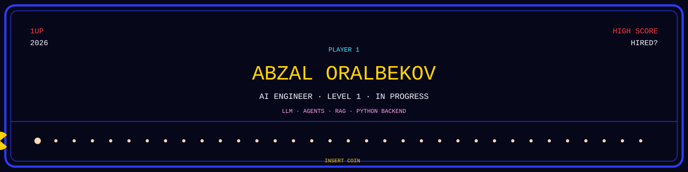

  

### `> PLAYER INFO`

Software engineering graduate from Astana, Kazakhstan.
Building backend and LLM projects and getting ready for the nFactorial AI Engineer program (starts Dec 2026).
Looking for an internship or junior role in AI engineering or Python backend.

### `> HIGH SCORE` · projects

| Project | What it does | Stack | Status |
|---|---|---|---|
| [logwatch](https://github.com/OralbekovAbzal/logwatch) | CLI that reads API access logs from stdin, computes error rate and p50/p95 per endpoint, checks SLO thresholds and reports the result via exit code | Python, GitHub Actions | 🟡 level 1 · tests in progress |
| [billing API](https://github.com/OralbekovAbzal/ai_prep/tree/main/m07-1_billing_api) | Credit billing for an AI video service: creates a generation job and charges the wallet in one transaction, row lock against double spending · [live demo](https://ai-prep-1-3qg4.onrender.com/docs) | FastAPI, PostgreSQL, Docker, Render | 🟡 level 1 |
| [ai_prep](https://github.com/OralbekovAbzal/ai_prep) | My practice repo: solutions to a 14-module plan from Python basics to LLM agents and RAG | Python, SQL, Docker | 🟢 updated daily |

### `> POWER-UPS` · stack

`Python` · `FastAPI` · `PostgreSQL` · `Docker` · `Git` · `GitHub Actions` · `pytest`

### `> NEXT LEVEL` · learning now

LLM APIs and structured output → agents and tool calling → RAG with pgvector

### `> GAME LOG` · contributions

  <picture>
    <source media="(prefers-color-scheme: dark)" srcset="https://raw.githubusercontent.com/OralbekovAbzal/OralbekovAbzal/output/pacman-contribution-graph-dark.svg">
    <source media="(prefers-color-scheme: light)" srcset="https://raw.githubusercontent.com/OralbekovAbzal/OralbekovAbzal/output/pacman-contribution-graph.svg">
    
  </picture>

### `> CONTACT`

[LinkedIn](https://www.linkedin.com/in/abzal-oralbekov-b538b1334) · Telegram [@oralbekkov](https://t.me/oralbekkov)
